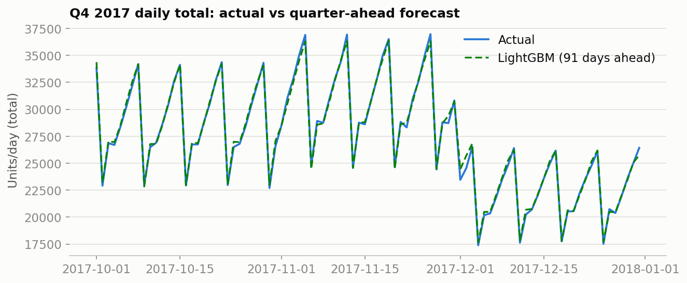
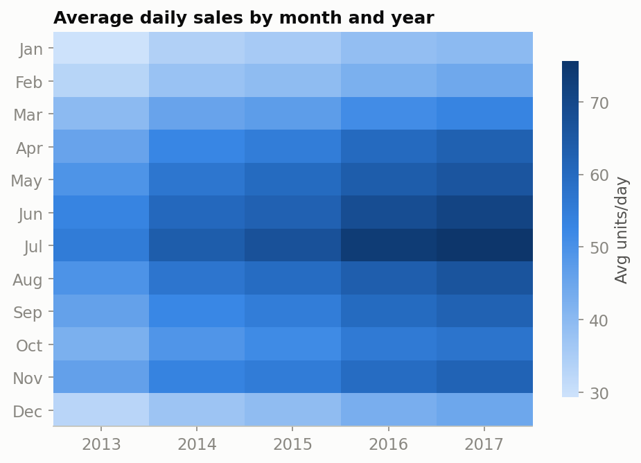

# Retail Demand Forecasting — End to End


Forecasting daily demand for **500 retail time series** (10 stores × 50 items, 5 years of sales) — from raw data to a backtested model that predicts **a full quarter ahead**.

## Results

A LightGBM model with horizon-safe features, backtested on every quarter of 2017 at a **91-day forecast horizon** (the model sees no sales data from the 3 months before each prediction):

| Model | Mean SMAPE (4 folds) | vs. baseline |
|---|---|---|
| Seasonal naive (same weekday, last year) | 17.15 | — |
| **LightGBM** | **12.07** | **~30% better, in every fold** |

For reference, top solutions of the original [Kaggle challenge](https://www.kaggle.com/c/demand-forecasting-kernels-only) score ~12.5 SMAPE on its 3-month test window.



*Total daily demand in Q4 2017 vs. the forecast made 91 days in advance — the weekly sawtooth and the December dip are reconstructed entirely from calendar features and year-old history.*

## Highlights

- **Forecasts that pay for themselves** — quantile forecasts feed a newsvendor ordering policy that cuts simulated Q4 inventory cost by **75%** ($516k → $129k) versus the naive policy.
- **Baseline first** — every model must beat a zero-parameter seasonal naive forecast before earning its complexity.
- **Leakage-safe by construction** — time-based train/validation splits; every lag and rolling feature uses only data strictly before the target date.
- **Horizon-aware evaluation** — beyond the usual 1-day-ahead scoring, a rolling-origin backtest reproduces the real deployment constraint: forecasting a quarter ahead with quarter-old data.
- **Tested, reusable code** — feature engineering, metrics and training live in [`src/`](src/) modules with unit tests run on GitHub Actions, including an [anti-leakage test](tests/test_features.py) that proves no feature can see data closer than the forecast horizon.
- **Narrated notebooks** — each notebook states its question, shows the evidence, and ends with findings that feed the next step.
- **Honest reporting** — caveats and scope notes included (e.g., why 91-day scores stay close to 1-day scores on this dataset).

## Pipeline

| Step | Notebook | What it does |
|---|---|---|
| 1 | [`01_eda.ipynb`](notebooks/01_eda.ipynb) | Trend, yearly/weekly seasonality, store/item heterogeneity, series-level noise |
| 2 | [`02_feature_engineering.ipynb`](notebooks/02_feature_engineering.ipynb) | 21 calendar, lag and rolling-window features per series → parquet |
| 3 | [`03_modeling.ipynb`](notebooks/03_modeling.ipynb) | Seasonal naive vs. LightGBM, time-based validation (SMAPE 18.6 → 12.4) |
| 4 | [`04_evaluation.ipynb`](notebooks/04_evaluation.ipynb) | 91-day-horizon backtest across all 2017 quarters |
| 5 | [`05_inventory_optimization.ipynb`](notebooks/05_inventory_optimization.ipynb) | Quantile forecasts → newsvendor ordering policy: **75% lower inventory cost** vs naive |



## Dataset

[Store Item Demand Forecasting Challenge](https://www.kaggle.com/c/demand-forecasting-kernels-only/data) (Kaggle): 913,000 rows of daily sales — 10 stores × 50 items × 2013–2017. The data is not versioned here; download `train.csv` from Kaggle into `data/raw/`.

## Project structure

```
├── data/              # raw & processed data (not versioned)
├── notebooks/         # numbered analysis notebooks (the pipeline)
├── src/
│   ├── data/          # loading
│   ├── features/      # leakage-safe feature engineering (horizon-aware)
│   ├── evaluation/    # metrics
│   └── models/        # LightGBM training
├── tests/             # unit tests (pytest), run in CI
├── outputs/
│   ├── figures/       # exported charts
│   ├── forecasts/     # model predictions (not versioned)
│   └── metrics/       # evaluation results (not versioned)
└── requirements.txt
```

## Reproduce

```bash
pip install -r requirements.txt
# place Kaggle train.csv in data/raw/, then run notebooks 01 → 04
```

## Roadmap

- [x] Extract feature/metric/training logic into `src/` modules with unit tests and CI
- [x] Inventory optimization: quantile forecasts → safety stock & service-level simulation
- [ ] Holiday calendar features
- [ ] Inventory carryover and order batching in the simulation

## License

[MIT](LICENSE)
